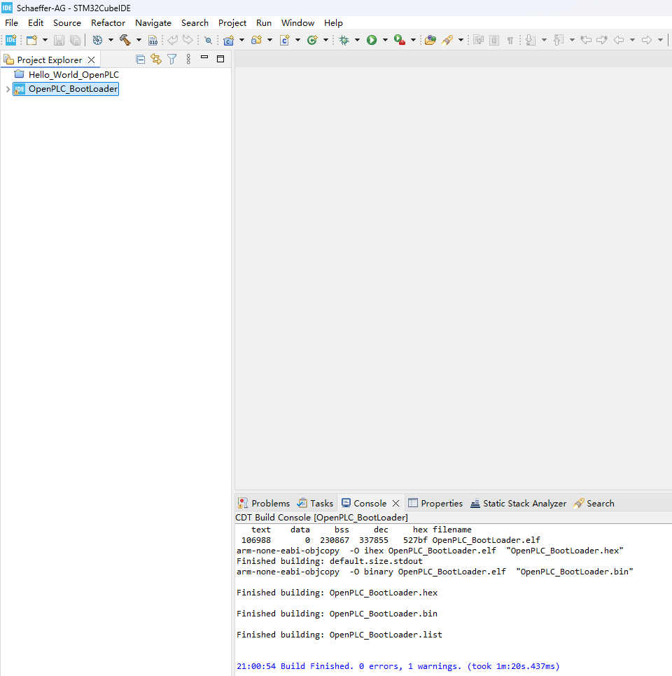
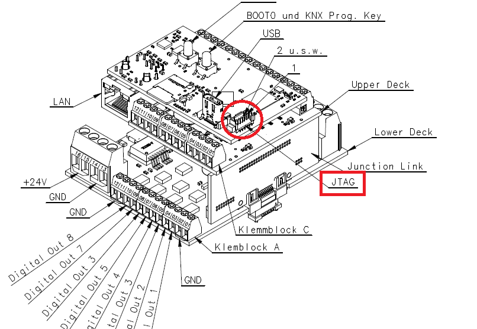
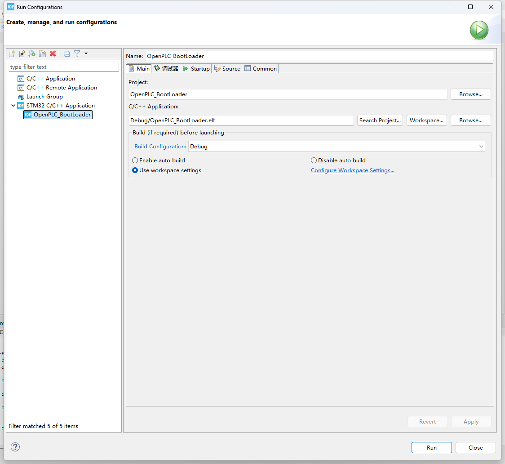
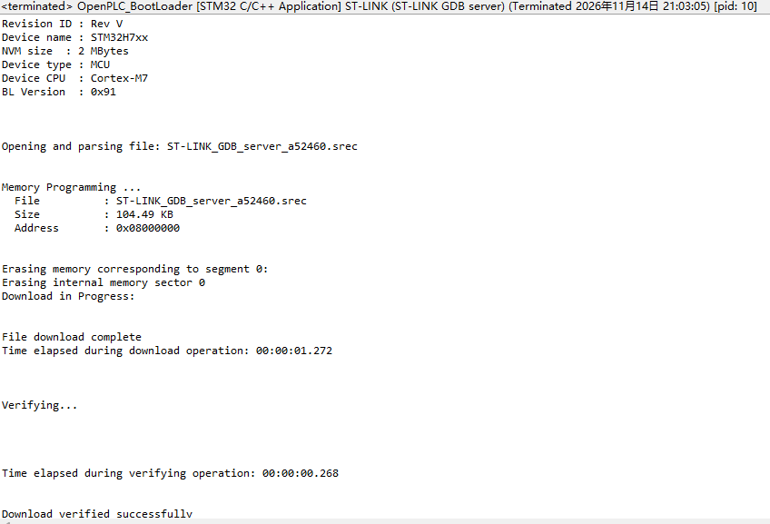
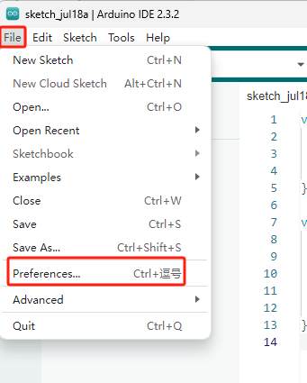
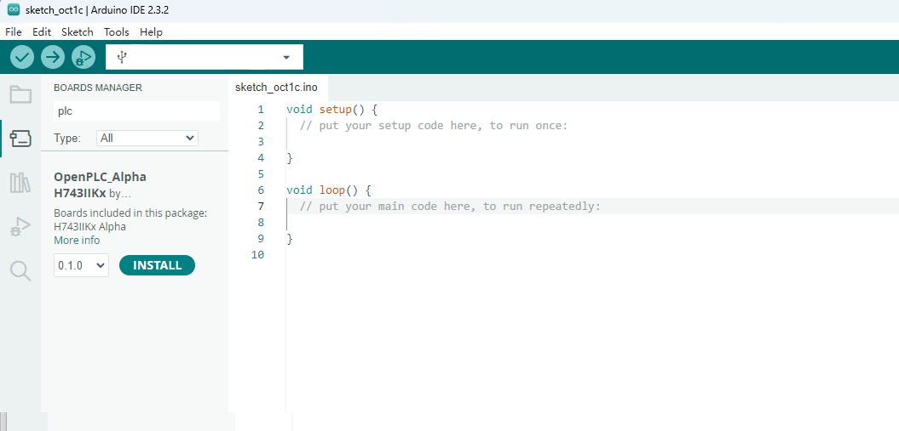
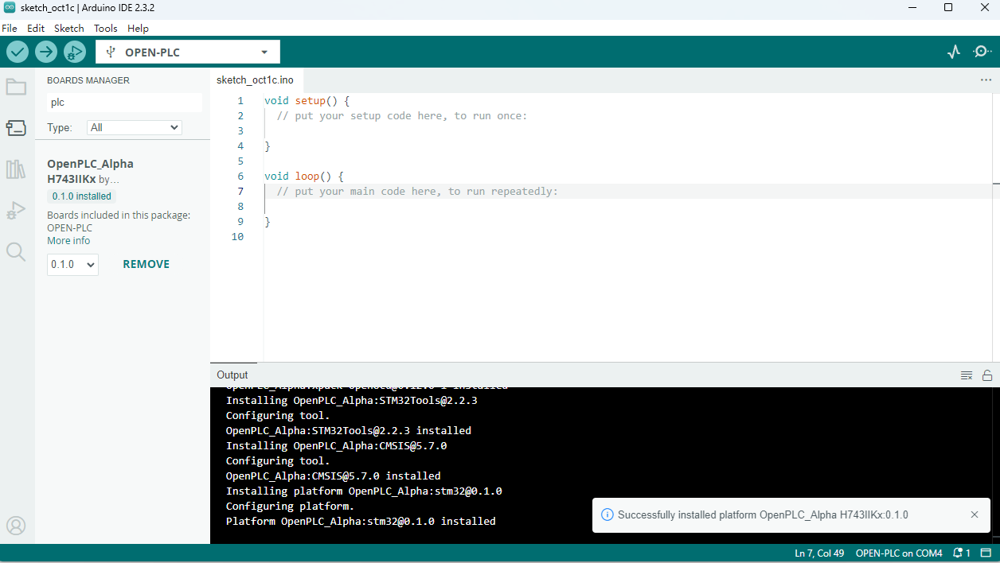
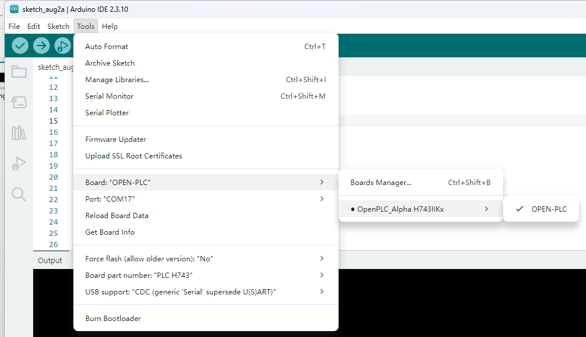
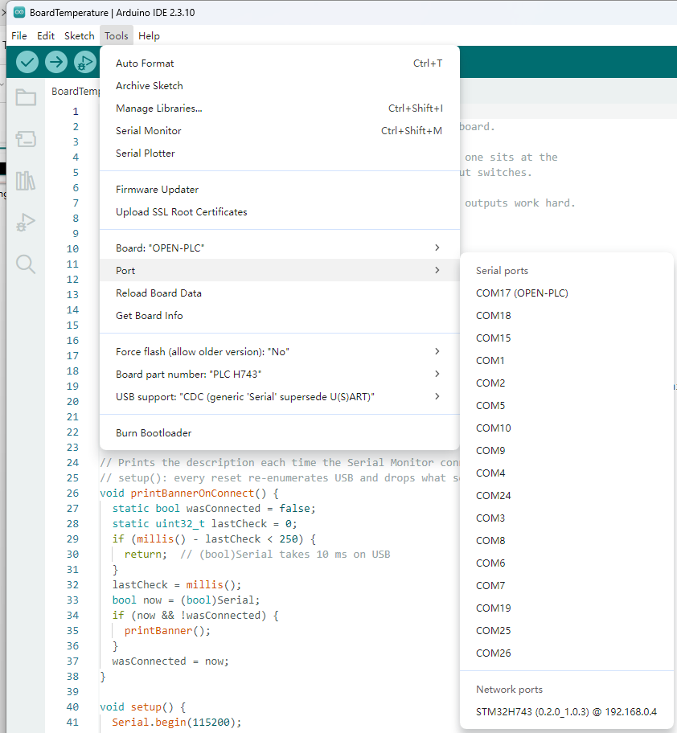
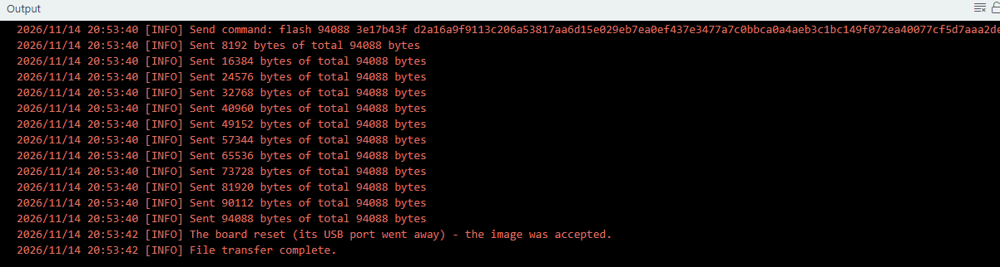

# OpenPLC user guide

How to set up the OpenPLC board (STM32H743) and program it from Arduino IDE, for release
0.2.0. Follow the steps in order the first time.

| Step | |
|---|---|
| 1 | [Download the software](#1-download-the-software) |
| 2 | [Flash the bootloader](#2-flash-the-bootloader) (once per board) |
| 3 | [Install the board package in Arduino IDE](#3-install-the-board-package-in-arduino-ide) |
| 4 | [Linux and macOS: permissions](#4-linux-and-macos-permissions) |
| 5 | [Upload a sketch](#5-upload-a-sketch) |
| 6 | [Keys: who may upload](#6-keys-who-may-upload) |
| 7 | [Factory reset](#7-factory-reset) |
| | [Troubleshooting](#troubleshooting) |

What changed in 0.2.0 and how to upgrade a board already in service:
[release notes](https://github.com/OpenPLCs/OpenPLC_BootLoader/blob/0.2.0/RELEASE-NOTES.md).

## 1. Download the software

| Software | What for | Needed |
|---|---|---|
| [Arduino IDE 2](https://www.arduino.cc/en/software) | Writing and uploading sketches | Always |
| An ST-LINK probe (SWD) and [STM32CubeIDE](https://www.st.com/en/development-tools/stm32cubeide.html) | Building and flashing the bootloader | Once per new board |
| [STM32CubeProgrammer](https://www.st.com/en/development-tools/stm32cubeprog.html) | Flashing the bootloader without STM32CubeIDE | Optional |

Windows, Linux and macOS all work. Connect the board's USB port to the PC; for uploads over
Ethernet, also connect it to a network where a DHCP server gives it an address.

## 2. Flash the bootloader

The bootloader is what lets Arduino IDE upload sketches. A board that already runs
bootloader 0.2.0 skips this step. A board with an older bootloader needs it, and its sketch
has to be uploaded again afterwards.

1. Get the source:

   ```
   git clone --branch v0.2.0 https://github.com/OpenPLCs/OpenPLC_BootLoader.git
   ```

2. In STM32CubeIDE: *File > Import > General > Existing Projects into Workspace*, select the
   cloned folder and import the project `OpenPLC_BootLoader`. Then *Project > Build Project*;
   the console ends with `0 errors`.

   

3. Connect the ST-LINK to the JTAG connector on the upper deck and power the board.

   

4. *Run > Run Configurations...*, select *STM32 C/C++ Application > OpenPLC_BootLoader* (the
   repository ships this configuration), *Run*. The console ends with
   `Download verified successfully`.

   

   

   With STM32CubeProgrammer instead: connect over ST-LINK (SWD), open
   `Debug/OpenPLC_BootLoader.hex`, *Download*.

   ⚠️ **Do not run a full chip erase.** The last flash sector holds the board's calibration
   values, written at production, and its owner record; a full chip erase deletes both.

5. Disconnect the probe and connect the board's USB port to the PC. A board without a sketch
   stays in the bootloader, and its USB port appears on the PC (`COMx` on Windows,
   `/dev/ttyACMx` on Linux).

## 3. Install the board package in Arduino IDE

1. *File > Preferences*, and add this line to *Additional boards manager URLs*:

   ```
   https://raw.githubusercontent.com/OpenPLCs/OpenPLC_Arduino_PKG_Json/master/package_openplc_alp_index.json
   ```

   

2. *Tools > Board > Boards Manager...*, search for `OpenPLC`, pick the newest version of
   **OpenPLC_Alpha H743IIKx** and click *Install*. An older version is upgraded in place.
   If you installed 0.2.0 before 2026-11-15, click *Remove* and then *Install* once: 0.2.0 was
   republished with the same version number, so the IDE does not offer it as an update.

   

   

3. **Close and restart Arduino IDE once.** The package brings an IDE extension that is
   loaded only at start-up.

4. *Tools > Board > OpenPLC_Alpha H743IIKx > OPEN-PLC*. Leave the other *Tools* menus at
   their defaults.

   

## 4. Linux and macOS: permissions

- **Linux: serial port.** Add your user to the `dialout` group, then log out and in again:
  `sudo usermod -aG dialout $USER`
  ([Arduino help](https://support.arduino.cc/hc/en-us/articles/360016495679-Fix-port-access-on-Linux)).
- **Scripts and tools.** The board package installs its scripts and tools as executables, so
  normally nothing is needed. Only if a build or an upload stops with `Permission denied`,
  make them executable.

  Linux:

  ```
  P=~/.arduino15/packages/OpenPLC_Alpha
  chmod +x $P/hardware/stm32/0.2.0/system/extras/*.sh \
           $P/hardware/stm32/0.2.0/tools/discovery/bin/linux_amd64/network_discovery \
           $P/tools/STM32Tools/0.2.0/linux/IAPTool
  ```

  macOS:

  ```
  P=~/Library/Arduino15/packages/OpenPLC_Alpha
  chmod +x $P/hardware/stm32/0.2.0/system/extras/*.sh \
           $P/hardware/stm32/0.2.0/tools/discovery/macos-launcher.sh \
           $P/hardware/stm32/0.2.0/tools/discovery/bin/darwin_*/network_discovery \
           $P/tools/STM32Tools/0.2.0/macosx/IAPTool*
  ```

## 5. Upload a sketch

1. **Pick the port** under *Tools > Port*. The board is listed once for each connection;
   the port you pick decides how the sketch is uploaded:

   | Port | Upload goes over |
   |---|---|
   | The board's USB serial port, labelled `OPEN-PLC` | USB |
   | The board under *Network ports*, shown as `STM32H743 (<package version>_<sketch version>) @ <IP address>` | Ethernet |

   Picking a port makes LED3 on that board blink fast for about 2 s, so you can tell
   several boards apart.

   

2. **Open an example** under *File > Examples > OpenPLC_Ports* (or `OpenPLC_KNX`,
   `OpenPLC_SDRAM`). Each example's header says what to connect and what you should see.
   Every sketch needs the line `OPENPLC_APP_VERSION(1, 0, 0);` (each field 0 to 255; raise
   it for each new release of your sketch); a sketch without it does not build.

3. **Click *Upload*.** If a sketch is running, the IDE asks it to restart into the
   bootloader; the board starts the new sketch when the upload is done.

   

The first upload to a new or factory-reset board makes it yours: see the next step.

An upload whose version is lower than the one the board runs is refused. To install an older
version anyway, set *Tools > Force flash (allow older version)* to **Yes**; it works once,
until the menu has been set back to **No** and an upload has run.

## 6. Keys: who may upload

A board runs only sketches signed with its owner's key.

- **The first upload claims the board.** A new or factory-reset board has no owner; the first
  upload makes this PC's key its owner. If the PC has no key yet, one is created and its path
  is printed in the upload output.
- **Back up the key file.** Without it nobody can upload to the board until it is
  factory-reset. To upload from another PC, copy the file to the same place there.

  | System | Key file |
  |---|---|
  | Windows | `%AppData%\openplc\keys\fw_signing_key.pem` |
  | Linux | `~/.config/openplc/keys/fw_signing_key.pem` |
  | macOS | `~/Library/Application Support/openplc/keys/fw_signing_key.pem` |

- **Lost the key:** [factory-reset](#7-factory-reset) the board, then upload.
- **Colleagues with their own keys, revoking them, handing a board to another owner:**
  [KEYS-AND-OWNERSHIP.md](docs/user/KEYS-AND-OWNERSHIP.md).

## 7. Factory reset

Removes the board's owner, so the next upload claims it again. Calibration values stay. The
sketch stays in flash but does not start until that upload.

1. Reset the board (RESET button, or switch it off and on). LED3 blinks fast for 2 s.
2. Press BOOT0 while LED3 blinks and keep holding it.
3. About 10 s after the reset LED3 lights steadily: the factory reset is armed.
4. Release BOOT0 within 30 s of the reset. The owner is removed and the board waits in its
   bootloader for an upload.

To cancel: reset the board while LED3 is lit steadily. Holding BOOT0 longer than 30 s also
cancels it.

### Entering the bootloader by hand

Needed when the running sketch does not answer an upload (for example `loop()` never returns),
and before `IAPTool revoke` or `setowner`:

1. Reset the board. LED3 blinks fast for 2 s.
2. Press BOOT0 while LED3 blinks, and release it as soon as LED3 stops blinking.

The board waits in its bootloader for an upload or a command. Do not hold BOOT0 while
switching on: it is also the chip's boot pin and keeps the bootloader from starting.

## Troubleshooting

| Symptom | Cause and fix |
|---|---|
| The board does not answer an upload while the sketch runs | The board serves the network and upload requests between `loop()` calls and inside `delay()`. Let `loop()` return, or [enter the bootloader by hand](#entering-the-bootloader-by-hand) |
| Upload refused: signature or owner mismatch | The board belongs to another key. Use that key, or [factory-reset](#7-factory-reset) the board |
| Upload refused with `"ERR"` right after `Certificate was issued by this board's root` | Your key was certified by the owner but has since been revoked. `IAPTool log <IP>` shows the reason on the board; ask the owner |
| The Serial Monitor shows nothing at 1200 baud | 1200 baud is reserved for uploads. Pick another rate |
| Lines starting with `[sys]` in the Serial Monitor | The board's system log; write `OPENPLC_SYSTEM_LOG(OFF);` in the sketch to turn it off |
| Linux: the IDE cannot open the USB port | [Add your user to `dialout`](#4-linux-and-macos-permissions) |

## Using the board in a sketch

Start from the examples. The library READMEs ship with the board package:
[OpenPLC_Ports](https://github.com/OpenPLCs/OpenPLC_Arduino_PKG/blob/v0.2.0/libraries/OpenPLC_Ports/README.md) ·
[OpenPLC_SDRAM](https://github.com/OpenPLCs/OpenPLC_Arduino_PKG/blob/v0.2.0/libraries/OpenPLC_SDRAM/README.md) ·
[OpenPLC_SD](https://github.com/OpenPLCs/OpenPLC_Arduino_PKG/blob/v0.2.0/libraries/OpenPLC_SD/README.md) ·
[OpenPLC_KNX](https://github.com/OpenPLCs/OpenPLC_Arduino_PKG/blob/v0.2.0/libraries/OpenPLC_KNX/README.md) ·
[ETS product](https://github.com/OpenPLCs/OpenPLC_ETS_Prod/blob/master/README.md) ·
[IAPTool commands](https://github.com/OpenPLCs/OpenPLC_IAPTool/blob/v0.2.0/README.md)

---

<details>
<summary><b>Design and engineering documents</b> (for developers; most users do not need them)</summary>


These say what the product is and why it is built this way: requirements, test cases,
decisions. The design documents are in Chinese. `$PROD` in a citation means this repository.

### Hardware

| Document | What it covers |
|---|---|
| [docs/hardware/HARDWARE-FACTS.md](docs/hardware/HARDWARE-FACTS.md) | Verified hardware facts, each linked to the schematic or datasheet it comes from |
| [docs/standards/IEC-61131-2.md](docs/standards/IEC-61131-2.md) | What IEC 61131-2 requires of this board |

### Modules

One main document per module (requirements, test cases, design), with its detail documents below it.

| Document | What it covers |
|---|---|
| [docs/modules/M1-firmware-upgrade.md](docs/modules/M1-firmware-upgrade.md) | M1 firmware upgrade: the bootloader and uploads |
| [docs/modules/M1/BOOT-SEQUENCE.md](docs/modules/M1/BOOT-SEQUENCE.md) | Start-up: deciding whether to stay in the bootloader or start the application |
| [docs/modules/M1/IAP-PROTOCOL.md](docs/modules/M1/IAP-PROTOCOL.md) | The commands bootloader and application accept on the wire |
| [docs/modules/M1/CHALLENGE-AUTH.md](docs/modules/M1/CHALLENGE-AUTH.md) | Challenge-response authorisation of state-changing commands |
| [docs/modules/M1/FLASHBOOT.md](docs/modules/M1/FLASHBOOT.md) | Replacing the bootloader in place (`flashboot`) |
| [docs/modules/M1/SECTOR-15.md](docs/modules/M1/SECTOR-15.md) | Layout of the last flash sector: calibration, root area, metadata |
| [docs/modules/M1/BOOT-LOG.md](docs/modules/M1/BOOT-LOG.md) | Boot log buffer in SRAM4 |
| [docs/modules/M2-ownership.md](docs/modules/M2-ownership.md) | M2 ownership and trust: root key, certificates, revocation, factory reset |
| [docs/modules/M3-app-runtime.md](docs/modules/M3-app-runtime.md) | M3 application runtime: the Arduino board package |
| [docs/modules/M3/USER-API.md](docs/modules/M3/USER-API.md) | API conventions for sketches |
| [docs/modules/M3/CONSTRAINTS.md](docs/modules/M3/CONSTRAINTS.md) | The design must not restrict the user's application |
| [docs/modules/M3/CALIBRATED-ANALOG.md](docs/modules/M3/CALIBRATED-ANALOG.md) | AI / AO in physical units with calibration values |
| [docs/modules/M3/KNX-TP-DATA-LINK.md](docs/modules/M3/KNX-TP-DATA-LINK.md) | KNX TP data link layer |
| [docs/modules/M4-production-fixture.md](docs/modules/M4-production-fixture.md) | M4 production fixture |
| [docs/modules/M4/PORTTOOL-FLOW.md](docs/modules/M4/PORTTOOL-FLOW.md) | Port test fixture: control model and per-port test procedure |
| [docs/modules/M4/PRODUCTION-FRAMEWORK.md](docs/modules/M4/PRODUCTION-FRAMEWORK.md) | Production test framework: plan files and step sequences |
| [docs/modules/M4/PROD-CONFIG-ITEMS.md](docs/modules/M4/PROD-CONFIG-ITEMS.md) | Production test configuration items |

### Repositories and build

| Document | What it covers |
|---|---|
| [docs/repo/ARCHITECTURE.md](docs/repo/ARCHITECTURE.md) | The repositories, the path variables (`$BOOT`, `$TOOL`, `$CORE_REPO`, `$PORTTOOL`, `$TEST`, `$PROD`), cross-repo mirrored code |
| [docs/build/BUILD-AND-TEST.md](docs/build/BUILD-AND-TEST.md) | How to build and test |
| [docs/build/BOOTLOADER-PROJECT-LAYOUT.md](docs/build/BOOTLOADER-PROJECT-LAYOUT.md) | Bootloader project layout: flash partitions, size budget, modules, lwIP |
| [docs/build/CUBEMX-RULES.md](docs/build/CUBEMX-RULES.md) | Rules for changing the CubeIDE project |

### Testing

| Document | What it covers |
|---|---|
| [docs/engineering/README.md](docs/engineering/README.md) | Engineering requirements |
| [docs/engineering/HOW-TO-RUN-TESTS.md](docs/engineering/HOW-TO-RUN-TESTS.md) | How to run the tests, and the pass criteria |
| [docs/engineering/TEST-DESIGN.md](docs/engineering/TEST-DESIGN.md) | How the tests are built, and why |
| [docs/engineering/BOOTLOADER-STAND-IN.md](docs/engineering/BOOTLOADER-STAND-IN.md) | Bootloader stand-in: the real code on the PC instead of a hand-written fake board |
| [docs/engineering/HOW-TO-RUN-PORTTOOL-TESTS.md](docs/engineering/HOW-TO-RUN-PORTTOOL-TESTS.md) | PortTool tests |

### Decisions and tables

| Document | What it covers |
|---|---|
| [GLOSSARY.md](GLOSSARY.md) | Product terms you cannot guess (cross-repo mirror, fixture, calibration values, root / leaf, ...) |
| [docs/tables/DECISIONS.md](docs/tables/DECISIONS.md) | Decisions already settled, with reasons and when to reopen them |
| [docs/tables/STATUS.md](docs/tables/STATUS.md) | Status summary: how far each requirement has got |
| [docs/tables/ACCEPTANCE-CHECKLIST.md](docs/tables/ACCEPTANCE-CHECKLIST.md) | Acceptance checklists |
| [docs/tables/DEFERRED-DESIGNS.md](docs/tables/DEFERRED-DESIGNS.md) | Designs worked out but deferred |
| [docs/tables/ID-MAP.md](docs/tables/ID-MAP.md) | Id registry: where each id lives |
| [docs/tables/RENAMED-IDS.md](docs/tables/RENAMED-IDS.md) | Renamed ids, old to new |

`tools/` holds the checks that guard these documents.

### Checks

```
python tools/check_docs.py
```

Runs P7 (requirements and test cases agree), P8 (no claim written in two documents),
P9 (every path a document names exists), P13 (no renamed id is still cited) and P18
(the id registry is up to date). P7, P9 and P13 also read the code repositories when
they are cloned beside this one; a repository that is missing is skipped by name.

</details>

## License

Copyright (c) 2024-2026 Schaeffer AG. Licensed under Creative Commons Attribution 4.0
International (CC BY 4.0), see `LICENSE`. The code in the sibling repositories has its own license.
