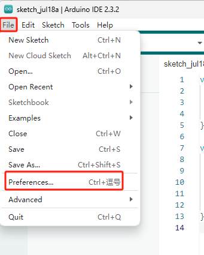
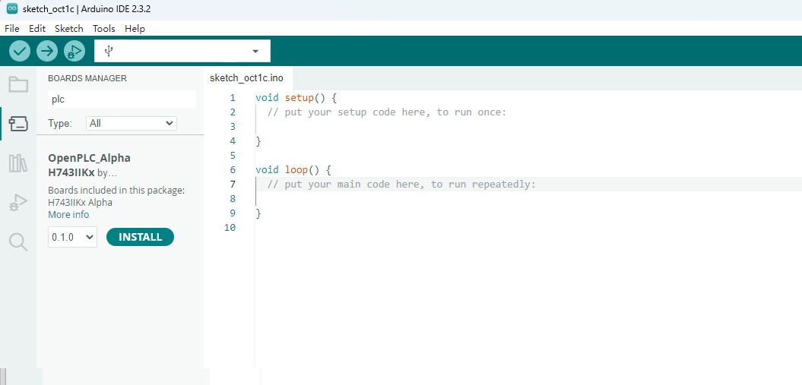
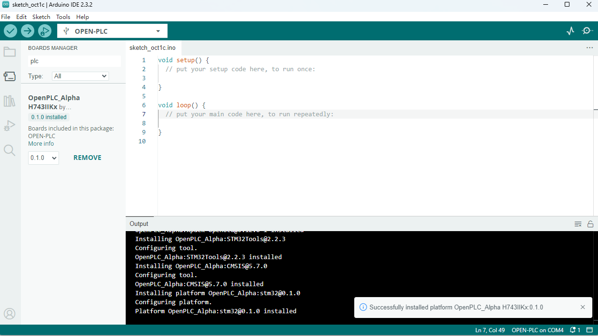

# Programming the board from Arduino IDE

## What you need

- [Arduino IDE 2](https://www.arduino.cc/en/software) on Windows, Linux or macOS
- A board running bootloader 0.2.0 ([FLASH-BOOTLOADER.md](FLASH-BOOTLOADER.md))
- A USB cable, or an Ethernet connection to a network where a DHCP server gives the board
  its address and the PC can reach it

## 1. Install the board package

1. *File > Preferences*, and add this line to *Additional boards manager URLs*:

   ```
   https://raw.githubusercontent.com/OpenPLCs/OpenPLC_Arduino_PKG_Json/master/package_openplc_alp_index.json
   ```

   

2. *Tools > Board > Boards Manager...*, search for `OpenPLC`, pick the newest version of
   **OpenPLC_Alpha H743IIKx** and click *Install*. An installed older version is upgraded in
   place; there is no need to remove it first. If you installed 0.2.0 before 2026-11-14,
   click *Remove* and then *Install* once: 0.2.0 was republished on 2026-11-13 and 2026-11-14
   with the same version number, so the IDE does not offer it as an update.

   

   

3. **Close and restart Arduino IDE once** after installing or upgrading. The package brings an
   IDE extension that is loaded only at start-up. If the *Tools* menus still look like the old
   version, use *Tools > Reload Board Data*.

4. *Tools > Board > OpenPLC_Alpha H743IIKx > OPEN-PLC*.

## 2. Pick the port

*Tools > Port* lists the board once for each connection it has. The port you pick decides how the sketch is uploaded;
there is no separate upload-method setting.

| Port | Upload goes over |
|---|---|
| The board's USB serial port (`COMx` on Windows, `/dev/ttyACMx` on Linux), labelled `OPEN-PLC` | USB |
| The board's network port (its IP address) | Ethernet |

Picking a port makes LED3 on that board blink for about two seconds, so you can tell several
connected boards apart.

## 3. Write the sketch

Every sketch must declare its own version with `OPENPLC_APP_VERSION`; a sketch without
it does not build.

```c
OPENPLC_APP_VERSION(1, 0, 0);   // required; raise it for each new release of your sketch

const int led = PE2;  // LED3, the system LED; on when high

void setup() {
  pinMode(led, OUTPUT);
}

void loop() {
  digitalWrite(led, HIGH);
  delay(500);
  digitalWrite(led, LOW);
  delay(500);
}
```

Each field is a number from 0 to 255. Ready-made examples for the board's ports, KNX and the
external SDRAM are under *File > Examples*, in the libraries `OpenPLC_Ports`, `OpenPLC_KNX`
and `OpenPLC_SDRAM`.

## 4. Upload

Click *Upload*. Nothing else is needed on the board: if a sketch is running, the IDE asks it to
restart into the bootloader, and the board starts the new sketch when the upload is done.

### The first upload claims the board

A board fresh from the factory, or after a factory reset, has no owner and runs nothing. The
first upload makes this PC's signing key its owner; from then on the board accepts only sketches
signed with that key. If the PC has no key yet, one is created and its path is printed in the
upload output.

**Keep a copy of the key file** ([where it is](KEYS-AND-OWNERSHIP.md#where-the-key-is)). To
upload from another PC, copy it to the same place there. Colleagues uploading with their own
keys, handing a board over and a lost key are in [KEYS-AND-OWNERSHIP.md](KEYS-AND-OWNERSHIP.md).

### Uploading an older sketch version

An upload whose `OPENPLC_APP_VERSION` is lower than the one the board is running is refused;
the same version or a higher one is accepted. To install an older version anyway, set
*Tools > Force flash (allow older version)* to **Yes**. It works once: the next forced upload is
refused until the menu has been set back to **No** and an upload has run.

## Starting the bootloader by hand

Needed when the running sketch cannot be reached, for example when `loop()` never returns and
never calls `delay()`.

1. Switch the board off and on.
2. As soon as LED3 starts blinking, press and hold the BOOT0 button until the blinking stops
   (about two seconds), then release it.

The board now waits in the bootloader on USB and Ethernet; upload as usual.

| ⚠️ | |
|---|---|
| Do not hold BOOT0 while switching on | The button is also the chip's boot pin: held at power-on, it keeps the bootloader from starting |
| Do not hold BOOT0 for 10 seconds | That arms a **factory reset**, shown by LED3 lit steadily; releasing the button then removes the board's owner. See [Factory reset](KEYS-AND-OWNERSHIP.md#factory-reset) |

## Troubleshooting

| Symptom | Cause and fix |
|---|---|
| Linux: the IDE cannot open the USB port | Add your user to the `dialout` group, then log in again ([Arduino help](https://support.arduino.cc/hc/en-us/articles/360016495679-Fix-port-access-on-Linux)) |
| The Serial Monitor shows nothing at 1200 baud | 1200 baud is reserved for uploads; the sketch's `Serial` output is not shown at that rate. Pick another rate |
| The board does not answer while the sketch runs | The board serves the network and upload requests between `loop()` calls and inside `delay()`. Let `loop()` return, or start the bootloader by hand as above |
| Upload refused: signature or owner mismatch | The board belongs to another key (`IAPTool getowner <board>` shows which). Use that key, or [factory-reset](KEYS-AND-OWNERSHIP.md#factory-reset) the board |
