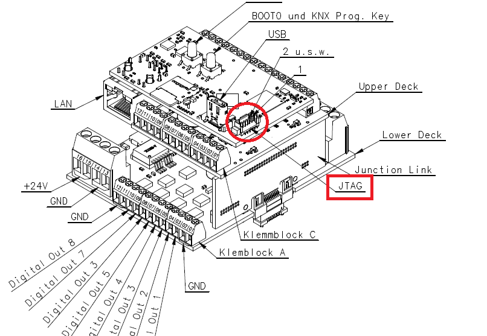

# Flashing the bootloader

The bootloader is what lets Arduino IDE upload sketches to the board over USB or
Ethernet. It is flashed once over an ST-LINK probe; after that every sketch goes
through Arduino IDE ([ARDUINO-IDE.md](ARDUINO-IDE.md)).

## When you need this

| Board | What to do |
|---|---|
| New board without a bootloader | Flash it as below |
| Board running a bootloader older than 0.2.0 | Flash it as below, then upload the sketch again with board package 0.2.0. Bootloader and board package go together; there is no in-place upgrade from an older bootloader ([release notes](https://github.com/OpenPLCs/OpenPLC_BootLoader/blob/v0.2.0/RELEASE-NOTES.md)) |
| Board already running bootloader 0.2.0 | Nothing. To replace it without a probe, see `IAPTool flashboot` in the [IAPTool README](https://github.com/OpenPLCs/OpenPLC_IAPTool/blob/v0.2.0/README.md) |

## What you need

- An ST-LINK probe (SWD)
- [STM32CubeIDE](https://www.st.com/en/development-tools/stm32cubeide.html) to build the bootloader;
  optionally [STM32CubeProgrammer](https://www.st.com/en/development-tools/stm32cubeprog.html) to flash it
- A USB cable from the board to the PC, to check the result

## 1. Get the source

```
git clone --branch v0.2.0 https://github.com/OpenPLCs/OpenPLC_BootLoader.git
```

## 2. Build

1. In STM32CubeIDE: *File > Import > General > Existing Projects into Workspace*, select the
   cloned folder and import the project `OpenPLC_BootLoader`.
2. *Project > Build Project*. The build ends with `0 errors` and writes
   `Debug/OpenPLC_BootLoader.elf`, `.hex` and `.bin`.

## 3. Connect the probe

Connect the ST-LINK to the JTAG connector on the upper deck and power the board.



## 4. Flash

Either tool works:

| Tool | Steps |
|---|---|
| STM32CubeIDE | *Run > Run Configurations...*, select *STM32 C/C++ Application > OpenPLC_BootLoader* (the repository ships this configuration), *Run*. The console ends with `Download verified successfully` |
| STM32CubeProgrammer | Connect over ST-LINK (SWD), open `Debug/OpenPLC_BootLoader.hex`, *Download* |

⚠️ **Do not run a full chip erase.** The last flash sector holds the board's calibration
values, written at production, and its ownership record; a full chip erase deletes both.
Flashing the bootloader image as above leaves that sector alone.

## 5. Check

Disconnect the probe, connect the board's USB port to the PC and power the board. A board
without a sketch stays in the bootloader, and its USB port appears on the PC
(`COMx` on Windows, `/dev/ttyACMx` on Linux). Continue with [ARDUINO-IDE.md](ARDUINO-IDE.md).
